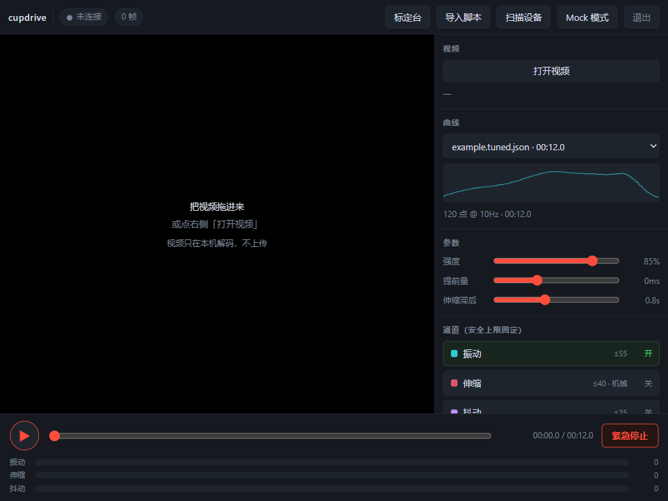

# cupdrive

**Turn any video into Bluetooth toy motion — offline, no account, no vendor content library.**



cupdrive reads a video's rhythm in the browser, tunes it into a rate-limited
motion curve, and plays it to a Bluetooth device over a reverse-engineered BLE
protocol. Video never leaves your machine.

Built and verified against **MIZZZEE XW (醉清风)**. The pipeline is generic;
other devices need a protocol mapping.

**Windows 10/11 x64** · **[Download](../../releases)** · **[中文使用说明](docs/usage.md)** · no Python, no installer

---

## What it does

| | |
|---|---|
| **Any video** | Audio RMS + 3-layer motion analysis + cut detection, all local in the browser |
| **Feels deliberate** | Slow rise, fast fall — the envelope the official app actually uses |
| **Three channels** | Vibration, thrust, shake. Hard caps 55 / 40 / 35 |
| **Stops when it should** | Session guard, 2-second watchdog, panic stop, zero on exit |
| **No cloud** | Binds to `127.0.0.1` only, token-protected API, no telemetry |

---

## Download

**Windows 10/11 x64** — grab `cupdrive-win64.zip` from
[Releases](../../releases), unzip anywhere writable (not `Program Files`), and
run `cupdrive.exe`.

> The exe is unsigned, so SmartScreen may warn on first launch:
> **More info → Run anyway**.

The UI opens in an app-mode Edge/Chrome window. Close it and the background
process exits after two idle minutes; there is also a **退出** button in the
header.

**中文使用说明：[docs/usage.md](docs/usage.md)** — 下载、标定、连接设备、参数、常见问题。

---

## How it works

```
video ──► web/index.html ──► script.json ──► tune.py ──► tuned.json ──► BLE device
           (browser)                          (numpy)                    (bleak)
                                             ▲
                            webapp.py + ui/app.html (local HTTP + browser shell)
```

1. **Calibrate** — drop a video into the calibration page; **⚡ 全自动** scans
   audio, motion and cuts, then exports `<name>.script.json`.
2. **Tune** — the desktop app denoises, stretches, fuses and rate-limits it
   into a playable curve.
3. **Play** — open the same video, pick the curve (it auto-matches by filename),
   connect the device, press play.

No hardware? **Mock 模式** runs the whole timeline, guard included, without BLE.

Five stages:

| Stage | What | Where |
|---|---|---|
| **Analyze** | Audio RMS + 3-layer motion analysis + cut detection | `web/index.html` |
| **Tune** | Denoise → percentile stretch → rate-limited envelope → breath | `cupdrive/tune.py` |
| **Guard** | Channel whitelist, per-channel caps, slew limit, fail-safe zero | `cupdrive/safety.py` |
| **Play** | 10 Hz curve playback, multi-channel with lag | `cupdrive/play.py` |
| **Desktop** | Video, curves, channel toggles, scan/connect, panic stop | `webapp.py`, `ui/app.html` |

The desktop shell is a local HTTP service plus an app-mode browser window.
Video decoding stays in the browser (no ffmpeg needed); BLE stays in Python.
Nothing is uploaded — the server binds to `127.0.0.1` only.

The desktop app defaults to **vibration only** (cap 55). Thrust (cap 40) and
shake (cap 35) are mechanical channels and require explicit confirmation.
`Esc` or **紧急停止** zeros everything immediately.

---

## Command line

```bash
pip install bleak numpy
```

**1. Capture a curve**

Open `web/index.html` in Chrome/Edge, drop a video in, hit **⚡ 全自动**. It
scans the file and downloads `<name>.script.json`.

**2. Tune it**

```bash
python -m cupdrive.tune path/to/script.json --out tuned.json
```

**3. Play it**

```bash
python -m cupdrive.play tuned.json --backend ble --wait
```

Press Enter the moment your video starts. Run without `--backend ble` to see
the intensity bar in the terminal — no hardware needed.

---

## The curve is the hard part

The naive approach — extract intensity, feed it to the motor — produces
something that feels like a broken massage chair. What actually works:

**1. The envelope is rate-limited, not smoothed.**

Watching 792 commands from the official app revealed the rule:

```
rise:  +1 step per command, never more    (16.5 units/s at 0-100 scale)
fall:  -5 steps per command allowed       (82.5 units/s)
```

Rise is 5× slower than fall. That asymmetry is why it reads as "restrained"
rather than "clingy". `tune.py` reproduces this directly:

```python
if target > v:  v = min(v + up_step,   target)   # slow climb
else:           v = max(v - down_step, target)   # fast retreat
```

**2. Denoise before stretching, never after.**

Raw audio RMS on a real clip gave `std=4.68` — essentially a flat line at 13%.
Stretching that first just amplifies noise. A 4-second moving average followed
by 5–95 percentile stretch gives `std=28.77`, and the actual beat structure
becomes visible.

**3. Blend audio and motion, then stretch once.**

Stretching each channel separately before combining destroys relative
information and pushes the mean high. Fuse the raw signals first, stretch the
result.

---

## Reverse-engineered protocol

Full notes in [`docs/protocol.md`](docs/protocol.md). Summary:

```
frame  = [0xAA, CMD, LEN, ...payload, CHECKSUM]
CHECKSUM = sum(all previous bytes) & 0xFF

0x0A  start/stop      [1] / [0]        ← MUST send start first
0x08  intensity       [t,v,s,r,dl,dh]  ← 4 channels + duration
0x04  heat            [1] / [0]
0x06  mode            5 bytes
```

Channel order, hardcoded in the app's `nC()`:

| idx | name | this device |
|---|---|---|
| 0 | thrust | ✅ 伸缩 |
| 1 | vibration | ✅ 振动 |
| 2 | suction | ⚠️ 抖动 (not suction!) |
| 3 | rotation | ❌ no hardware |

**There is no authentication.** The app's `verifyApp()` / `verifyDevice()` are
empty stubs. Any client that knows the UUIDs and frame format can drive the
device.

> Note: the vendor app sets all four channels to the same slider value.
> **Do not do that.** Channel 2 on this hardware is a high-frequency shake, and
> channel 0 is a mechanical stroke that can pinch. Driving all four at once is
> how you get hurt. See the safety section.

---

## Safety

`cupdrive/safety.py` exists because a test run pinched a hand.

Five gates, all mandatory:

1. **Channel whitelist** — mechanical channels (thrust/suction/rotate) refuse
   to activate unless explicitly allowed.
2. **Per-channel caps** — thrust 40, vibration 55, shake 35. Hand-tuned, not
   theoretical maxima.
3. **Slew limiting** — 25 units/s. No jumps.
4. **Fail-safe** — pause, panic, exception, disconnect and process exit all
   zero the device before releasing it.
5. **Watchdog** — if the UI stops sending for 2 seconds, the service zeros the
   device itself.

```python
from cupdrive.safety import MultiGuard
from cupdrive import protocol as P
guard = MultiGuard({P.CH_VIB: 55, P.CH_THRUST: 40})
```

**Test procedure for any new device:** one channel at a time, smallest value
first (3, then 5, 8, 12), hands off the hardware.

---

## Build a release

```bat
release.bat
```

Produces `release\cupdrive-win64.zip` (≈21 MB compressed, Python bundled).
Upload it:

```bash
gh release create v0.3.0 release/cupdrive-win64.zip --title "cupdrive v0.3.0"
```

The build has no pythonnet dependency — BLE goes through `bleak`, the UI
through a local HTTP server, so PyInstaller produces a working exe.

---

## Status

Working, hand-tuned, not polished.

- [x] Protocol verified byte-for-byte against hardware
- [x] Browser curve editor with audio + motion analysis
- [x] Official-derived rate-limited envelope
- [x] Multi-channel playback with lag
- [x] Hard caps + session guard + watchdog + panic stop
- [x] Desktop GUI — video, curves, one-click tune, scan/connect, mock mode
- [x] Standalone Windows build (no Python required on the user's machine)
- [ ] Support for other device models
- [ ] Preset library

---

## Disclaimer

For private, personal use with hardware you own. Reverse engineering for
interoperability. No warranty — this drives physical machinery, so test
carefully and keep your hands clear during discovery.

Full terms, safety rules and liability limits:
[docs/usage.md §9](docs/usage.md#9-免责声明与使用条款).
