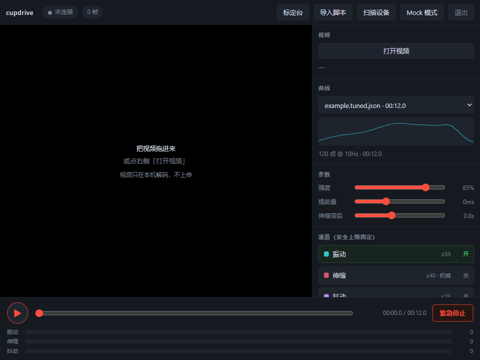

# cupdrive

[English](README.md) | **简体中文**

### [⬇ 下载 Windows 版（x64，21 MB）](https://github.com/t4ngk1ng-droid/cupdrive/releases/latest/download/cupdrive-win64.zip)

> 不需要 Python，不需要安装器。解压后双击 `cupdrive.exe`。

> **English：[README.md](README.md)** · **使用说明：[docs/usage.md](docs/usage.md)**

**把任意视频变成设备动作——离线、免账号、不依赖厂商内容库。**



cupdrive 在浏览器里读取视频的节奏，加工成限速的运动曲线，再通过逆向得到的 BLE 协议驱动蓝牙设备。视频不离开你的电脑。

针对 **MIZZZEE XW（醉清风）** 开发和验证。管线是通用的，其他设备需要先做协议映射。

**Windows 10/11 x64** · **[下载](../../releases)** · **[English](README.md)** · 不需要 Python，不需要安装器

---

## 它能做什么

| | |
|---|---|
| **任意视频** | 浏览器内做音频 RMS、三层画面运动、切镜检测 |
| **像有分寸** | 慢升快降——复刻官方 App 实际使用的包络 |
| **三个通道** | 振动、伸缩、抖动，硬上限 55 / 40 / 35 |
| **该停就停** | 会话代号、2 秒看门狗、急停、退出归零 |
| **不联网** | 只绑 `127.0.0.1`，令牌保护 API，无遥测 |

---

## 下载

**Windows 10/11 x64**——
**[下载 `cupdrive-win64.zip`](https://github.com/t4ngk1ng-droid/cupdrive/releases/latest/download/cupdrive-win64.zip)**
（21 MB），解压到有写权限的目录（不要放 `Program Files`），双击 `cupdrive.exe`。

> exe 没有代码签名，首次启动 SmartScreen 会提示：
> **更多信息 → 仍要运行**。

界面会在 Edge/Chrome 的应用窗口里打开。关掉窗口后，后台进程会在两分钟
空闲后自动退出；顶栏也有 **退出** 按钮。

**详细使用说明：[docs/usage.md](docs/usage.md)**——下载、标定、连接设备、参数、常见问题。

---

## 工作流程

```
视频 ──► web/index.html ──► script.json ──► tune.py ──► tuned.json ──► BLE 设备
         (浏览器)                          (numpy)                     (bleak)
                                             ▲
                            webapp.py + ui/app.html (本地 HTTP + 浏览器壳)
```

1. **标定**——把视频拖进标定台，点 **⚡ 全自动**，扫描音频、画面和切镜，导出 `<视频名>.script.json`。
2. **加工**——桌面版做降噪、拉伸、融合和限速，生成可播放的曲线。
3. **播放**——打开同一个视频，选曲线（按文件名自动匹配），连接设备，点播放。

没有硬件？**Mock 模式**会走完整时序，包括安全护栏，只是不发蓝牙。

五个阶段：

| 阶段 | 做什么 | 位置 |
|---|---|---|
| **分析** | 音频 RMS + 三层画面运动 + 切镜检测 | `web/index.html` |
| **加工** | 降噪 → 百分位拉伸 → 限速包络 → 呼吸 | `cupdrive/tune.py` |
| **护栏** | 通道白名单、每通道上限、限速、异常归零 | `cupdrive/safety.py` |
| **播放** | 10 Hz 曲线播放，多通道带滞后 | `cupdrive/play.py` |
| **桌面** | 视频、曲线、通道开关、扫描连接、急停 | `webapp.py`, `ui/app.html` |

桌面壳是一个本地 HTTP 服务加一个应用模式浏览器窗口。视频解码留在浏览器
（不需要 ffmpeg），BLE 留在 Python。所有数据都在本机——服务只绑
`127.0.0.1`。

桌面版默认**只开振动**（上限 55）。伸缩（上限 40）和抖动（上限 35）是
机械通道，需要显式确认。`Esc` 或 **紧急停止** 会立即归零。

---

## 命令行

```bash
pip install bleak numpy
```

**1. 抓曲线**

用 Chrome/Edge 打开 `web/index.html`，拖入视频，点 **⚡ 全自动**，会下载
`<视频名>.script.json`。

**2. 加工**

```bash
python -m cupdrive.tune path/to/script.json --out tuned.json
```

**3. 播放**

```bash
python -m cupdrive.play tuned.json --backend ble --wait
```

视频开始的同时按回车。不加 `--backend ble` 时只在终端显示强度条，不需要
硬件。

---

## 曲线才是难点

最直接的做法——提取强度，喂给马达——做出来的东西像一台坏掉的按摩椅。
真正有效的是：

**1. 用限速，不用平滑。**

看官方 App 的 792 条命令，规律是：

```
上升：每条命令 +1，绝不多加      （0-100 刻度下 16.5 单位/秒）
下降：每条命令最多 -5            （82.5 单位/秒）
```

上升比下降慢 5 倍。这个不对称让动作显得"克制"而不是"黏人"。`tune.py`
直接复刻：

```python
if target > v:  v = min(v + up_step,   target)   # 慢升
else:           v = max(v - down_step, target)   # 快降
```

**2. 先降噪，再拉伸，顺序不能反。**

真实片段的原始音频 RMS 是 `std=4.68`——基本是 13% 的平线。先拉伸只会
把噪声放大。4 秒移动平均再做 5–95 百分位拉伸，`std=28.77`，节拍结构才
显现出来。

**3. 先融合音频和画面，再统一拉伸。**

分别拉伸再合并会丢失相对信息，把均值顶高。先融合原始信号，再拉伸结果。

---

## 逆向得到的协议

完整笔记在 [`docs/protocol.md`](docs/protocol.md)。摘要：

```
frame  = [0xAA, CMD, LEN, ...payload, CHECKSUM]
CHECKSUM = sum(all previous bytes) & 0xFF

0x0A  start/stop      [1] / [0]        ← 必须先发 start
0x08  intensity       [t,v,s,r,dl,dh]  ← 4 通道 + duration
0x04  heat            [1] / [0]
0x06  mode            5 bytes
```

通道顺序，来自 App 的 `nC()`：

| idx | 名称 | 本机硬件 |
|---|---|---|
| 0 | thrust | ✅ 伸缩 |
| 1 | vibration | ✅ 振动 |
| 2 | suction | ⚠️ 抖动（不是吮吸） |
| 3 | rotation | ❌ 无此硬件 |

**没有认证。** App 的 `verifyApp()` / `verifyDevice()` 是空函数。任何知道
UUID 和帧格式的客户端都能驱动设备。

> 注意：厂商 App 会把四个通道设成同一个滑条值。**不要这么做。** 本机的
> 通道 2 是高频抖动，通道 0 是可能夹手的机械行程。四个一起开就是受伤的
> 开始。见安全一节。

---

## 安全

`cupdrive/safety.py` 存在，是因为一次测试夹到了手。

五道闸门，全部强制：

1. **通道白名单**——机械通道（伸缩/夹吸/旋转）必须显式允许才启用。
2. **每通道上限**——伸缩 40，振动 55，抖动 35。手调的，不是理论最大值。
3. **限速**——25 单位/秒，不允许跳变。
4. **异常归零**——暂停、急停、异常、断连、进程退出，都先归零再释放设备。
5. **看门狗**——界面 2 秒没有新帧，服务端自己归零。

```python
from cupdrive.safety import MultiGuard
from cupdrive import protocol as P
guard = MultiGuard({P.CH_VIB: 55, P.CH_THRUST: 40})
```

**任何新设备的测试规程**：一次只开一个通道，从最小值开始（3、5、8、12），
手离开硬件。

---

## 打包发布

```bat
release.bat
```

生成 `release\cupdrive-win64.zip`（约 21 MB 压缩，内含 Python）。上传：

```bash
gh release create v0.3.2 release/cupdrive-win64.zip --title "cupdrive v0.3.2"
```

构建不依赖 pythonnet——BLE 走 `bleak`，界面走本地 HTTP 服务，所以
PyInstaller 能稳定产出可运行的 exe。

---

## 状态

能用、手调过、不算精致。

- [x] 协议已逐字节对着真机验证
- [x] 浏览器曲线编辑器（音频 + 画面分析）
- [x] 官方 App 反推的限速包络
- [x] 多通道带滞后播放
- [x] 硬上限 + 会话代号 + 看门狗 + 急停
- [x] 桌面 GUI——视频、曲线、一键加工、扫描连接、Mock 模式
- [x] 独立 Windows 包（用户机器不需要 Python）
- [x] 界面中英切换（桌面版 + 标定台）
- [ ] 支持其他设备型号
- [ ] 预设曲线库

---

## 免责声明

仅供个人、在自己拥有的硬件上使用。逆向工程目的是互操作。不提供任何
担保——它会驱动真实机械，探索阶段请保持手离开设备。

完整条款、安全规则和责任限制：
[docs/usage.md §9](docs/usage.md#9-免责声明与使用条款)。
